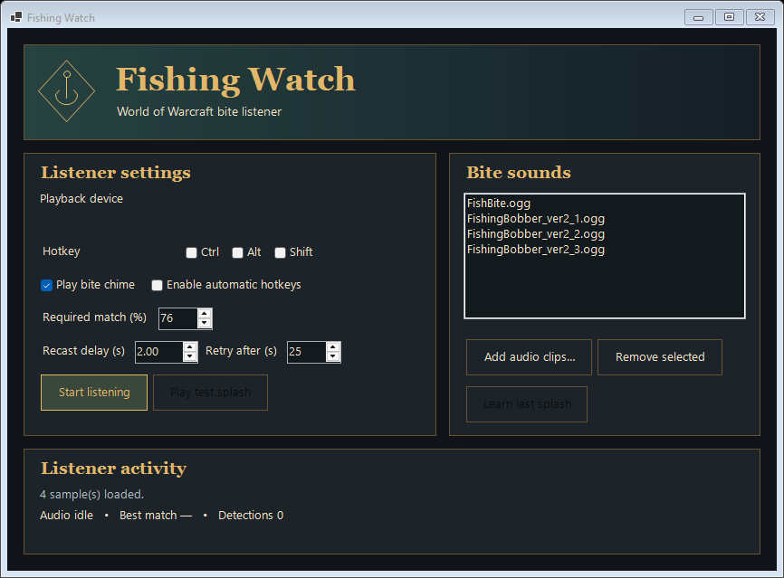
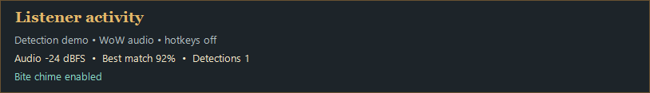

# Fishing Watch

Fishing Watch is a free, portable Windows app that listens for the World of Warcraft bobber splash. It was built for WoW Forever and can listen to the game separately from music, videos, and voice chat on supported Windows versions.

**[Download Fishing Watch for Windows x64](https://github.com/colyolyoctopus-dev/fishing-watch/releases/latest)**

## Screenshots

**Fishing Watch v1.1.0** with the bite chime on and automatic hotkeys off.

**Detection demo** with an example audio level, match score, and one detected bite.

## Get started

1. Download **Fishing-Watch-Windows-x64.zip**, extract it, and open **FishingWatch.exe**. The ZIP includes the Windows runtime. No installer is needed.
2. Click **Add audio clips** and load a short recording of the bite sound. The app accepts OGG, WAV, and MP3. The ZIP contains no game audio. For WoW Forever, see the [FishBite sound playlist](https://www.wowhead.com/forever/sound=3355/fishbite) for the four bite variants.
3. Open WoW, select **World of Warcraft only** under **Playback device**, and click **Start listening**. Game-only capture requires Windows build 20348 or later. If that option is unavailable, select the speakers or headset playing the game.
4. Fish normally with hotkey mode off. Watch the audio level, best match, and detection count to see whether the app is hearing and recognizing the bite.

## How detection works

Fishing Watch compares incoming audio with the clips you supply. It looks at how the sound’s loudness and frequency balance change over time. The **Required match** setting controls how closely a sound must match a reference. A higher threshold reduces false detections but can miss quieter or less similar bites.

**Fishing Watch can miss bites or mistake a similar sound for one.** Game-only capture filters out other apps, while in-game ambience and effects can still affect the result. If the audio meter moves but bites go unrecognized, try a clip from your own setup. In game-only mode with hotkey mode off, click **Learn last splash** immediately after a bite, then restart listening to use the new reference. Learned references last until you close the app.

## Optional hotkey mode

**Better Fishing is required for the supported automatic cast-and-reel setup.** Install [Better Fishing from CurseForge](https://www.curseforge.com/wow/addons/better-fishing) and configure its one-key fishing binding. Confirm the key casts and reels in when you press it manually in WoW, then select that same key in Fishing Watch. Detection-only mode works without the addon.

Fishing Watch starts in detection-only mode. The optional hotkey mode sends your assigned key to a focused WoW window and has configurable recast and missed-cast retry timing. **Blizzard prohibits unauthorized gameplay automation.** Review its policy before enabling this mode. [Blizzard End User License Agreement](https://www.blizzard.com/en-us/legal/simple/bfbbb648-bcc6-4b78-a5c7-e2fe20c135df/blizzard-end-user-license-agreement)

## Feedback

If you report a missed bite or a false detection, include your WoW edition, Windows version, capture mode, and the match score you saw. [Open an issue](https://github.com/colyolyoctopus-dev/fishing-watch/issues/new).

Fishing Watch is an independent project and is unaffiliated with Blizzard Entertainment.
